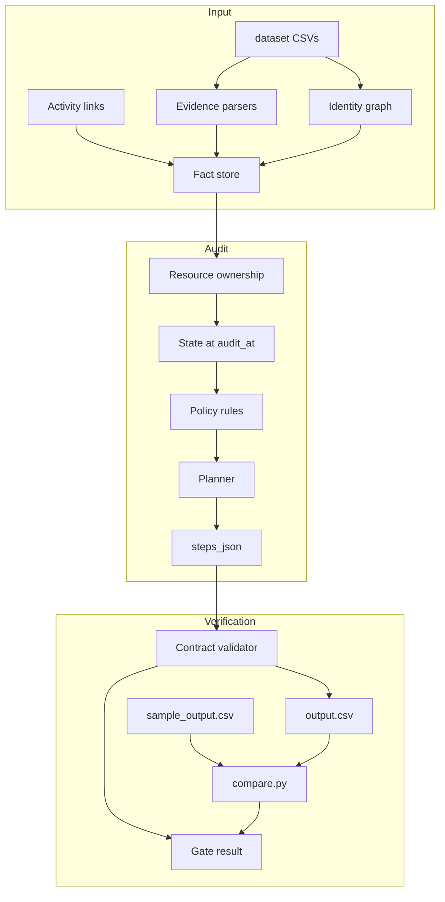

# Ghost Data Still Exists — Deletion Audit Agent

This repository contains a deletion audit agent for the HackerRank Orchestrate
October 2026 challenge. The agent reads 518 deletion requests. It decides if
each deletion is complete. It writes one row for each request to `output.csv`.

The agent uses only the supplied data. It does not use a language model. It does
not use the network. The result is deterministic.

## Quick start

```bash
git clone https://github.com/LangerSword/hackerrank-orchestrate-october26.git
cd hackerrank-orchestrate-october26
./scripts/fetch_dataset.sh
python3 code/main.py
```

The command writes `output.csv` in the repository root.

To run the sample check:

```bash
python3 code/main.py --sample
python3 analysis/compare.py
```

To run the contract check:

```bash
python3 code/evaluation/main.py
```

Requirements: Python 3.10 or later. The runtime uses the standard library only.
The dataset is not stored in this repository. `scripts/fetch_dataset.sh` gets
it from the official starter repository.

## How the agent works



The steps are:

1. `tables.py` builds one identity for each person. It uses the current email,
   phone and hash. It also uses all historical values in `user_audit_log.csv`.
2. `evidence.py` reads each evidence file. It reads JSON, SQL, logs, text, PDF
   and image digests. It makes one fact for each observed resource state.
3. `index.py` links each fact to a person. A link can come from an identifier,
   a user ID, an earlier snapshot, or a catalog activity.
4. `state.py` selects the newest fact for each resource. The fact must be at or
   before `audit_at`. A row in any replica counts as present.
5. `policy.py` applies `deletion_rules.csv`. It maps each data category to
   DELETE, REDACT, ANONYMIZE or RETAIN.
6. `planner.py` writes the findings. It writes the remediation steps. It writes
   the verification steps. It uses the required order.
7. `validate.py` checks the output contract. It checks the row count, the step
   numbers, the phase order, the citation rules and the time rules.

The agent treats a reported status as a claim. It treats an activity SUCCESS as
a claim. It does not use either one as proof.

## Output

`output.csv` has this header:

```text
case_id,deletion_status,steps_json
```

The file has 518 data rows. The rows are sorted by `case_id`.

Each step has these fields: `step_no`, `phase`, `system_id`, `resource_id`,
`operation`, `state`, `evidence_id`.

Phases are ordered: FINDING, REMEDIATION, VERIFICATION.

## Verification

The repository includes four checks.

| Check | Command | Result |
|---|---|---|
| Public sample | `python3 code/main.py --sample && python3 analysis/compare.py` | 32/32 statuses, 167/193 steps, 0 extra steps, F1 0.928 |
| Contract | `python3 code/evaluation/main.py` | 518 rows, 0 validator errors |
| Negative controls | `python3 analysis/test_eval_negative.py` | 12/12 illegal outputs caught |
| Intent probes | `python3 analysis/test_intent.py` | 140/140 self-authored probes |

The full run gives 152 COMPLETE, 356 INCOMPLETE and 10 NOT_APPLICABLE.

The output is deterministic. Two runs give the same SHA-256:
`be792f801a96a9fbd67eb12fe63e290bdb54bc8f51f13f3e497dcd236115a63b`.

Two independent checks support the evidence parsers:

- A state oracle read 959 log lines and 761 JSON records again. It found 0
  disagreements with the fact store.
- A SQL oracle read 66 SQL-only COMPLETE cases again. It found 0 disagreements.

The agent makes 0 model calls. It makes 0 network calls.

## Limits

The sample has 26 verification steps that the agent cannot attribute. The
records have no subject identifier after deletion or anonymisation. The agent
does not guess these resource IDs. The best activity-based guess scored 43.8%.
The break-even point is 46.3%.

Two cases have a known evidence conflict:

- `case_63`: the image shows one owner. A catalog link 7 minutes later shows a
  different owner. The agent keeps the resource link and reports the conflict.
- `case_55`: the backup console shows no restore policy. The agent reads the
  backup as a restore risk. The image does not state this directly.

These limits are recorded in `docs/DECISIONS.md`. The agent does not invent data
to remove them.

## Repository map

```text
code/
  main.py                 entry point
  audit/                  identity, evidence, state, policy, planner, validator
  evaluation/             evaluation and usage reports
  tools/                  digest builder
analysis/
  compare.py              sample diff
  test_eval_negative.py   validator negative controls
  test_intent.py          intent probes
docs/
  DECISIONS.md            design decisions and measurements
scripts/
  fetch_dataset.sh        dataset loader
output.csv                final predictions
log.txt                   agent session log
```
